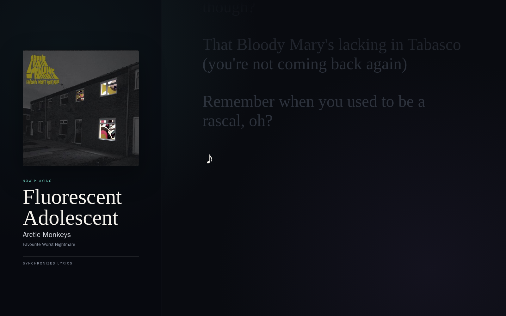

# SUB/WAVE Lyrics

A fullscreen lyrics display for [SUB/WAVE](https://www.getsubwave.com/) internet radio stations.
Open it on a desktop, phone, tablet, or wall display and it automatically follows the station,
showing synchronized LRCLIB lyrics when available and clean plain lyrics otherwise.




## Features

- Automatically follows `/api/now-playing`; no searching or song selection
- Synchronized lyric highlighting and restrained auto-scroll
- Plain-lyrics and unavailable states
- Artwork proxied through the app
- SQLite success, miss, and temporary-error cache
- Careful artist/title/album/duration matching with compilation and guest-credit fallbacks
- Configurable stream-latency compensation
- Optional active-viewer listener so SUB/WAVE does not idle-pause while a display is open
- Responsive, dark, fullscreen-friendly interface
- No admin credentials, telemetry, analytics, or advertising

## Quick start

Download [`compose.yaml`](compose.yaml), then create a `.env` file beside it:

```env
SUBWAVE_STATION_URL=https://radio.example.com
PORT=8095
PLAYBACK_OFFSET_SECONDS=22
```

Run:

```bash
docker compose up -d
```

Open `http://YOUR-SERVER:8095`.

The published image supports `linux/amd64` and `linux/arm64`:

```text
ghcr.io/sovereignalmida/subwave-lyrics:latest
```

## Build it yourself

```bash
git clone https://github.com/sovereignalmida/subwave-lyrics.git
cd subwave-lyrics
cp .env.example .env
# Edit SUBWAVE_STATION_URL in .env
docker compose -f compose.yaml -f compose.build.yaml up -d --build
```

## Existing SUB/WAVE stack

[`examples/compose.subwave.yaml`](examples/compose.subwave.yaml) is an overlay for the official
split-container Compose deployment. It uses `controller:7701` and `broadcast:7702` internally:

```bash
docker compose \
  -f docker-compose.yml \
  -f /path/to/subwave-lyrics/examples/compose.subwave.yaml \
  up -d subwave-lyrics
```

This is optional. A standalone deployment pointed at the station's public origin works just as well.

## Configuration

| Variable | Default | Purpose |
|---|---:|---|
| `SUBWAVE_STATION_URL` | — | Public station origin; derives `/api` and `/stream.mp3` |
| `SUBWAVE_API_URL` | derived | Optional internal controller URL override |
| `SUBWAVE_STREAM_URL` | derived | Optional internal stream URL override |
| `SUBWAVE_POLL_INTERVAL` | `2` | Now-playing polling interval in seconds |
| `KEEP_STATION_ACTIVE` | `true` | Hold one stream listener while a display is open |
| `VIEWER_TTL_SECONDS` | `45` | Release listener after the last browser heartbeat |
| `PLAYBACK_OFFSET_SECONDS` | `22` | Delay lyrics to account for stream buffering |
| `LRCLIB_BASE_URL` | `https://lrclib.net` | Lyrics provider base URL |
| `LRCLIB_NEGATIVE_CACHE_HOURS` | `12` | Retry interval for genuine misses |
| `DATABASE_PATH` | `/data/lyrics.db` | SQLite cache path |
| `PORT` | `8095` | Published host port in standalone Compose |
| `BIND_ADDRESS` | `0.0.0.0` | Published host interface in standalone Compose |
| `LOG_LEVEL` | `INFO` | Application log level |

Positive playback offsets delay lyric highlighting. SUB/WAVE commonly advertises a 22-second stream
buffer, but the best value depends on the station and playback device.

## How it works

1. The backend polls SUB/WAVE's public now-playing API.
2. A new `subsonic_id + timestamp` identifies each play, including consecutive repeats.
3. SQLite is checked before LRCLIB is queried.
4. LRCLIB candidates are scored using normalized artist, title, album, and duration.
5. The browser advances a local clock between API refreshes and scrolls only when the active line changes.

SUB/WAVE can idle-pause after a period with no Icecast listeners. When
`KEEP_STATION_ACTIVE=true`, an open lyrics page sends a heartbeat and the backend holds one stream
connection. It releases the connection shortly after the last display closes.

## API

- `GET /api/display` — combined station, track, playback, and lyrics state
- `GET /api/status` — connectivity and stream state
- `GET /api/now-playing` — current track and timing
- `GET /api/lyrics` — current lyrics
- `GET /api/artwork/current` — proxied cover art
- `POST /api/viewer-heartbeat` — mark a display active
- `GET /healthz` — process and SQLite health

## Troubleshooting

```bash
docker compose ps
docker compose logs --tail 100 subwave-lyrics
curl http://localhost:8095/healthz
```

- **Track appears but lyrics do not:** LRCLIB may not have the recording or may be temporarily busy.
  Temporary failures retry automatically; genuine misses are negatively cached.
- **Highlighting is early or late:** adjust `PLAYBACK_OFFSET_SECONDS` and recreate the container.
- **Station pauses:** leave `KEEP_STATION_ACTIVE=true` and verify the browser heartbeat reaches the app.
- **Private stations:** listener-password support is not included in the initial release. Never provide
  the station's admin credentials.

## Privacy and security

The service is self-hosted. It does not collect telemetry. Track metadata is sent directly from your
server to LRCLIB for lookup. No lyric text or station metadata is sent to the project author.

See [SECURITY.md](SECURITY.md) for reporting and credential guidance.

## License

[MIT](LICENSE)
